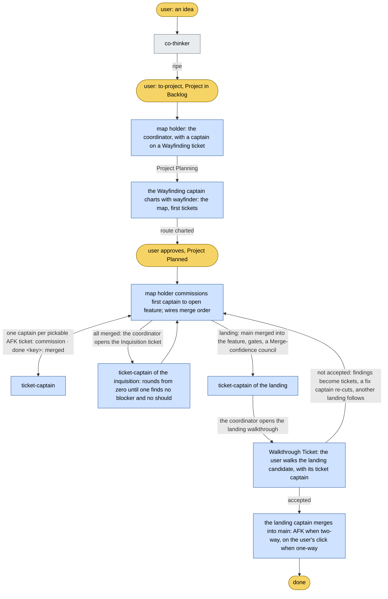
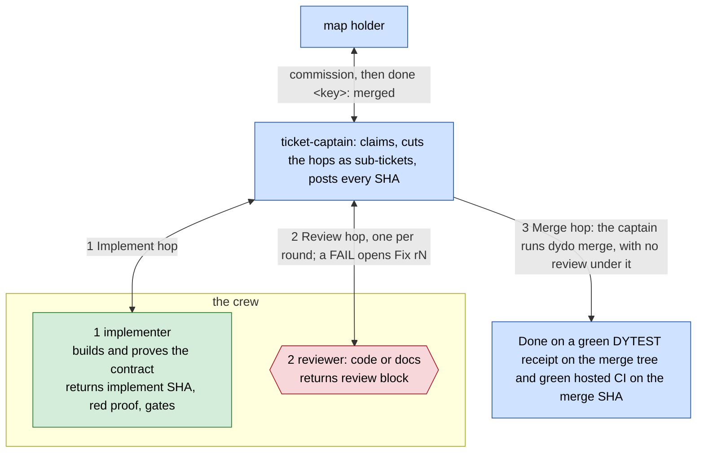

# Dydo

## What it is
Dydo is my opinionated workflow to build software projects with agents.
It has:
- Skills
	- Telling agents how to get work done, what roles they should play and how they should interact with the other agents
- A CLI tool which
	- Scaffolds the docs and wires the guard hook into Codex and Claude Code
	- Has a nudge system which uses Regex patterns in a guard hook to deny/warn on agent actions with helpful messages like
		- Don't hand-edit migrations, use "X" instead.
		- Don't invoke "this command" like this use it "like this"
	- Provides other handy commands like
		- Proxies a python swiss-army knife test runner script
		- Checks for broken links in the docs
- Documentation structure
	- [Diátaxis](https://diataxis.fr/) inspired structure
		- Guides
		- Reference
		- Understand
		- Project
		- Glossary
	- Auto generated placeholder files like
		- About
		- Architecture
		- Coding Standards

## How to use it
Don't. Seriously. Build your own system.
Because it should reflect:
- How you work
- What you work on
- With what stack
- What "good" (code) looks like to you

So I suggest you cherry pick ideas, fork the project, point your agent at it, steal what you need.
You can use it as is (as I use it), but it will reflect MY values and not necessarily yours.
It is built to be customizable, but only to a degree. If you still want to give it a try as is point your agent to [Getting Started](https://github.com/bodnarbalazs/dydo/blob/master/dydo/guides/getting-started.md) and follow their instructions.

## Axioms
Everything in Dydo follows from seven axioms, and every change is judged against them ([the full page](https://github.com/bodnarbalazs/dydo/blob/master/dydo/law/dydo/axioms.md)):
1. I can't scale; agents can.
2. Align intent: the system is an extension of my will, values and taste.
3. An agent's context is finite.
4. Everything evolves, so the system stays modular and light.
5. Efficiency: the best result for the time and tokens spent.
6. Agents are set up for success: the easy path is the right path.
7. Agents can verify their own work, so by the time a PR reaches me I have very high confidence it's correct.

## Overview
So how does dydo work in practice?

I break the work with a software product into many Linear projects. Each project is a map, where the tickets are the nodes, they are marked with statuses and labels. Every open project has a coordinator: a mechanical agent that keeps the Ticket Captains moving, watches that they're alive and paces the merges. Anything needing judgement goes to a fresh agent on its own ticket: re-charting the map goes to a captain on a Wayfinding ticket, hard calls to a council, and only what's worth my time comes to me. The Ticket Captains oversee the completion of the tickets with their crew of implementers, reviewers, researchers and scouts.

Each ticket is either AFK or HITL
- AFK is completed without me if everything goes according to plan
- HITL happens with my direct involvement and guidance

These are the types of tickets:
- Feature
	- Some new feature is being built or improved upon
- Bug
	- A bug gets reported, then it gets reproduced and fixed
- Enablement
	- Some user-involved setup which other work depends on (creating an api key)
- Inquisition
	- An audit where sub agents not only look at the code like reviewers, but also try to come up with ways which it could break and they test these hypotheses out to verify them
- Grilling
	- An agent asks me questions about my intent and vision, I understand and weigh the choices and out of these sessions come Decision Records, plans and further tickets which can be navigated
- Merge
	- Each project is a feature branch, each ticket where code gets written is a sub branch and each lane or sub ticket within that ticket also gets its child branch so agents never collide. When these are merged back to their parent, it's a merge ticket.
- Prototype
	- An interactive session where throwaway code gets created mostly for UI decisions, the winner code may become preserved as a starting guide for the actual implementation
- Question
	- When some decision is needed which is not answerable from any previous artifact (implementation plan, DR, docs, etc.) work stops until it's resolved so things don't go in incorrect ways
- Research
	- When some question needs to be answered there is a research work where an agent sends out scouts then verifies the evidence and presents the findings
- Walkthrough
	- Happens each time the feature is merged back to master (or when requested), this is the final, hands-on review where things get spot checked by me and I get in touch with the codebase so I understand what's going on and if I don't like something I'll send it back to be fixed

Here are some nice charts about the workflow:

One Project, from idea to landing:



One ticket, inside its captain's loop:



here's the whole flow as statecharts, every state and arrow citing the spec: [the dydo statechart](https://github.com/bodnarbalazs/dydo/blob/master/claims/statechart/README.md)
and here's the Linear setup dydo and the agents expect: [Linear Workspace Standard](https://github.com/bodnarbalazs/dydo/blob/master/dydo/reference/linear-workspace-standard.md)

## Installation

```bash
# npm (recommended)
npm install -g dydo

# .NET global tool
dotnet tool install -g dydo
```

Claude Code must be 2.1.281 or later to read `AGENTS.md`, the one entry file dydo writes.

## Quick start

Run from the project root:

```bash
dydo init codex       # or: dydo init claude / dydo init all / dydo init none
dydo check            # validate the documentation tree
dydo fix              # repair supported documentation issues
```

Every mode writes `dydo.json`, the `dydo/` documentation tree and `AGENTS.md`, the one entry file Claude Code and Codex both read. The `claude`, `codex`
and `all` modes also wire `dydo guard` as a hook for the chosen hosts, set the host's agent spawn
depth, and add the host's skill folder to `.gitignore`. `none`
wires no host. Initialization creates durable Decisions, changelog and pitfalls documentation;
live work, FutureFeatures included, stays in Linear.

Fill in `dydo/understand/about.md` and `dydo/understand/architecture.md`, then adapt
`dydo/guides/coding-standards.md` and `dydo.json` to the project. Use `dydo init <integration> --join`
when wiring another host or machine into an existing project. The full checklist, Linear workspace
and host configuration included, is
[Getting Started](https://github.com/bodnarbalazs/dydo/blob/master/dydo/guides/getting-started.md).

## Install the skills

The skills do not come with the npm or .NET package, and `dydo init` does not write them. Each skill
is one plain `skills/<category>/<name>/` folder in the [dydo repository](https://github.com/bodnarbalazs/dydo).
Before the first agent session:

1. Copy `skills/`, `setup-skills.mjs` and `THIRD-PARTY-NOTICES.md` from the dydo repository into
   the project root, leaving out each skill's test tree. The notices carry the MIT licences of the
   adapted skills and travel with them. Clone the repository outside the project, then run from
   the project root, `<tag>` being the release to install:

   ```bash
   git clone https://github.com/bodnarbalazs/dydo <clone>
   git -C <clone> archive -o dydo-skills.tar <tag> -- skills setup-skills.mjs THIRD-PARTY-NOTICES.md ":(exclude,glob)skills/**/test/**" ":(exclude,glob)skills/**/tests/**"
   tar -xf <clone>/dydo-skills.tar
   ```

   A skill's test tree is any `test` or `tests` folder inside its `skills/<category>/<name>/`
   folder. dydo keeps the trees of its own skills in its repository and runs them there; a skill
   only the project has keeps its own tests.
2. Commit them. They are the project's own from then on: edit them in place. To update them
   later, load the `update-dydo` skill.
3. Run `node setup-skills.mjs`. It links every skill folder, flat, into `.claude/skills/` and
   `.agents/skills/`.

The script always creates both folders, and `dydo init` and every `dydo init <integration> --join`
add both to `.gitignore` in every mode - `/.claude/skills/` for Claude Code and `/.agents/skills/`
for Codex. Each clone runs `node setup-skills.mjs` once. The script is safe to rerun. It checks its whole plan
before creating anything, stops at the first collision it names, and never replaces host
configuration or unrelated skills. OpenCode may read the same two folders; that is untested, and
dydo has no OpenCode init mode.

## Commands

| Command | Description |
|---|---|
| `dydo init <integration>` | Initialize for `claude`, `codex`, `all`, or `none` |
| `dydo init <integration> --join` | Wire another host or machine into an existing project |
| `dydo adopt <version>` | Record the dydo release the project adopted (`dydoVersion` in `dydo.json`) |
| `dydo check [path]` | Validate documentation |
| `dydo fix [path]` | Apply supported documentation repairs |
| `dydo index [path]` | Overwrite `index.md` with a fixed navigation page |
| `dydo graph <file>` | Show document graph connections |
| `dydo graph stats [--top N]` | Rank documents by incoming links |
| `dydo guard` | Evaluate one tool call against the hook rules and nudges (run by the hooks) |
| `dydo validate` | Validate local configuration and nudges |
| `dydo gap-check [args]` | Run the test runner configured in `dydo.json`, passing the arguments through |
| `dydo mode show` / `dydo mode set <flag> <value>` | List or set this machine's mode flags (`overnight`) |
| `dydo clean [<worktree>...] [--all]` | Remove linked worktrees, archiving their uncommitted work first (`--dry-run` previews) |
| `dydo pr-ready [path] [--body <file>]` | Check a tree is committed and pushed before a PR opens (`--body` also checks the PR body) |
| `dydo map [--no-browser]` | Serve a read-only map of a Linear Project on localhost (needs `LINEAR_API_KEY`) |
| `dydo survey <project>` | Print a read-only digest of a Linear Project's lanes (needs `LINEAR_API_KEY`) |
| `dydo completions <shell>` | Print a completion script for `bash`, `zsh`, or `powershell` |
| `dydo version` | Print the version |
| `dydo help` | Print the command summary |

Options, examples and exit codes are in the
[command reference](https://github.com/bodnarbalazs/dydo/blob/master/dydo/reference/dydo-commands.md).

## License

MIT - see LICENSE.
