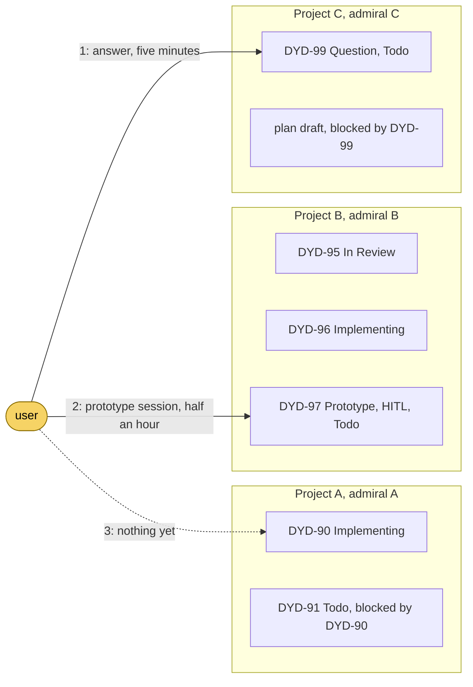

# Control Flow: A Day and the Prompt Files

[Control Flow](./control-flow.md)

## 7. A day with three Projects

The target the model is built for: the user's queue is never empty and never a wall. Every item on
it has its homework done, so the user's minutes go to judgment, taste and direction: an answer, a
reaction to a prototype, an approval, a Milestone walkthrough, a landing. Agents never wait on the user
without a `Question` in `Todo`, and the user never waits on agents: when the queue empties, the next
idea goes to a co-thinker. Priority on what waits on him says which comes first: the one that frees
the most AFK work.

This day the user has invoked three admirals for throughput: three top-level sessions in three terminals, each in its feature worktree; their
captains are sub-agents in ticket worktrees. The user's own terminal wears chief-of-staff to read the
queue, and co-thinker or a HITL ticket's captain, a Prototype's among them, to act on it.

A snapshot at 10:40:

| Project | Status | Session | In flight | Waits on the user |
|---|---|---|---|---|
| A: Reqnroll in DynaDocs | `In Progress` | admiral A | DYD-90 `Implementing`; DYD-91 `Todo`, blocked by DYD-90, whose outcome it builds on | nothing |
| B: Notion export | `In Progress` | admiral B | DYD-95 `In Review`; DYD-96 `Implementing`; DYD-97 Prototype, HITL, `Todo`, `High`: its verdict frees DYD-98 | a captain session on the prototype |
| C: Attention taxonomy | `Planning` | admiral C | its charted route, blocked by DYD-99 Question in `Todo`, `High`: the whole Project waits | an answer |

The chief-of-staff's three lists at that moment: *Answer needed*, DYD-99, `High`, a five-minute
answer; *Approval needed*, none; *Landing*, none. DYD-97, also `High`, waits on the user's captain
session rather than an answer. Then, in order:

1. **10:40.** The user answers DYD-99 on the ticket and tells admiral C; the blocker clears; admiral
   C finishes charting the route for user approval.
2. **10:45.** The user opens a captain session on DYD-97, the prototype: a UI question, two
   variants to react to in that session. While it runs, DYD-90's code-writer returns and its reviewer PASSes; its captain
   opens the PR, sets `Ready to Merge` and returns `done DYD-90: PR ready`; admiral A resumes it for the
   Merge Sub-ticket, whose review PASSes; DYD-91's blocker clears and it gets a captain. DYD-95's
   reviewer FAILs on one finding; its captain routes it to a fresh code-writer and the ticket shows
   `Implementing`.
3. **11:15.** The prototype's verdict is on DYD-97 with the winning commit and the user tells
   admiral B, which graduates the answer into DYD-98, a delivery ticket. Project C's charted route
   waits for approval: the next item on the queue.
4. **11:20.** The user reads the charted destination and first tickets in admiral C's terminal and
   approves; the Project is `Planned`; admiral C commissions its first captain to open the feature
   from the approved main SHA before claiming its ticket.
5. **11:30.** The queue is empty. Admiral A has two captains running, admiral B one and a fresh
   review, admiral C one. The user takes the next raw idea to a co-thinker, or walks a Milestone
   that merged since morning.

## 8. Prompt-file propagation - DYD-90

The authored contacts now carry DR 047. DYD-90's specification pins the file boundary and proof;
its candidate receives independent docs review and root contact review before integration.
Completed rows below name the source, not a claim that generated runtime output has been refreshed.

| File | Disposition |
|---|---|
| ~~admiral~~ | Authored: optional, only when the user invokes it (DR 051); charts with `wayfinder` as map holder; board wakes, planning/review/user approval, captain commissions and merge ordering; no Git beyond its plan's commits; landing and walkthrough. |
| ~~ticket-captain~~ | Authored: specify first, lanes/empty hops, statuses, four-field reviewer brief, two-step returns, release and Merge FAIL. |
| ~~project-planner~~ | Removed by DR 051: the map holder charts with `wayfinder`, and `to-ticket` carries upstream tracer bullets and blockers. |
| ~~specifier, implementer, hardener~~ | Retired: the single `code-writer` absorbs all three (DYD-222); the `Specifying` and `Hardening` statuses retired on 2026-09-23. |
| ~~reviewer~~ | Authored: four-field brief, pinned block on work judged, same merge rubric at every level. |
| ~~docs-writer~~ | Authored: captain invocation, committed evidence and inquisition record. |
| ~~inquisitor~~ | Authored: read-only captain assignment, findings/hypotheses with proof seam; no workflow verify job. History: DR 059 rebuilt it as the Read, Break and Drive phases. |
| ~~chief-of-staff~~ | Authored: Questions plus user gates, priority and released blockers; prototype retention follows delivery completion. |
| ~~co-thinker~~ | Authored: explicit to-project graduation, atomic five-field contract, FutureFeature status. |
| ~~wayfinder~~ | Authored: map holder at both levels, local/Project Question scope, Merge order. |
| ~~to-project, wizard~~ | Authored imports with pinned MIT provenance; wizard shell example shipped through Markdown resource. |
| compiler workflow emission | Retired by DR 049: the compiler is gone, so there is no workflow discovery, emission, or summary. Roles are native `SKILL.md` folders. |
| ~~types.json~~ | Inspected: document vocabulary already has inquisition and no workflow; Linear's ten Types are a separate standard. |
| dydo init | Deferred to DYD-86: native nesting depth and host setup proof. |
| ~~working-tree standard~~ | Authored/local twin: captain's Merge at each level, branch exceptions, release and merge-commit landing. |
| getting-started | Deferred to DYD-91: framework setup checklist and template registration. |
| ~~dydo.json~~ | Removed in source: no model or effort property remains; the delegating role chooses both at dispatch (DYD-134). |
| ~~work-model, task-lifecycle, dydo-glossary~~ | Authored/local prose: current flow, Types, release, Questions, inquisition and supersymmetry. |
| generated skills, agents, framework hashes and host reflection | Retired by DR 049: roles are native `SKILL.md` folders, edited directly; no compiler, hashes, or generated agent files remain. |

## Related

- [Control Flow](./control-flow.md)
