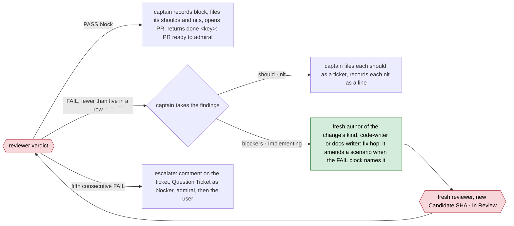
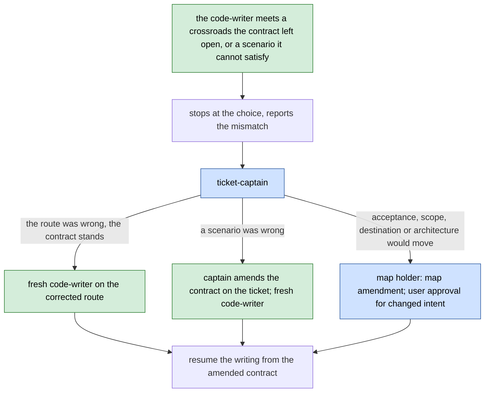
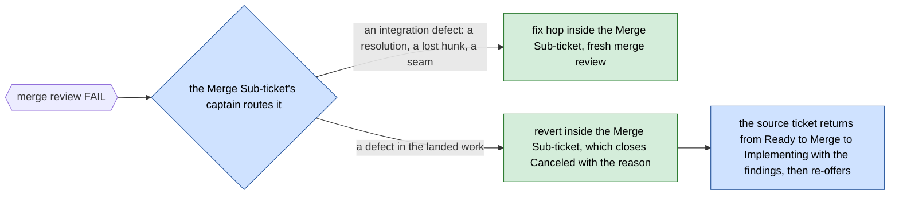
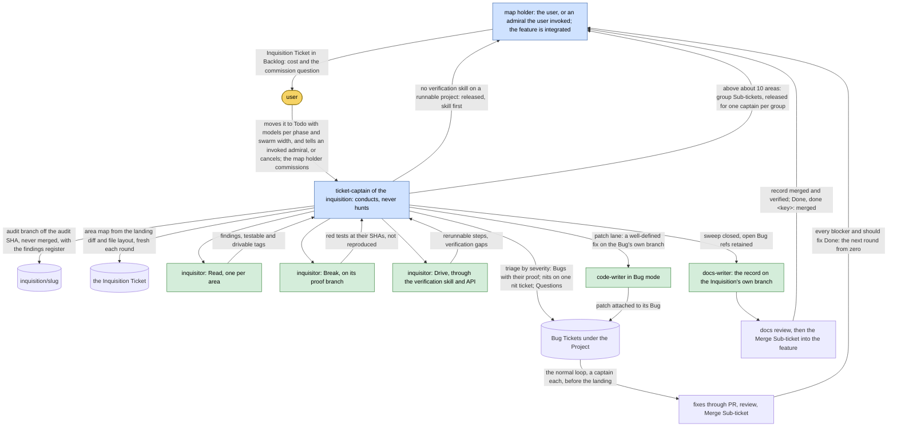
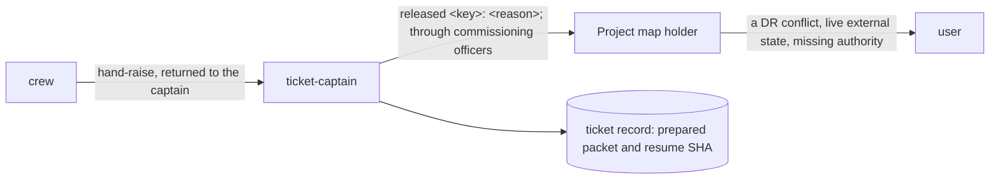
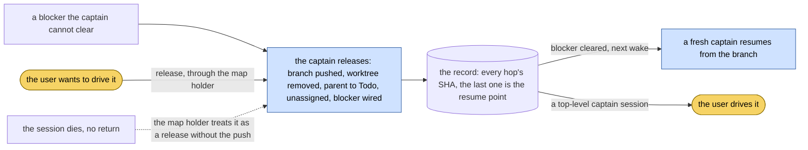

# Control Flow: Exceptions

[Control Flow](./control-flow.md)

## 6. Exceptions

### 6.1 A crew member raises a hand

Fog inside a ticket. The rule is fog → discovery → question ticket, and the Question is the last rung.

```mermaid
sequenceDiagram
  participant W as crew
  participant C as ticket-captain
  participant R as research
  participant A as admiral
  participant B as Linear
  participant H as user
  W->>C: hand-raise: question, sources searched, why it blocks, options found
  C->>C: bounded discovery: DRs, plan, ticket links, glossary, code, tests
  alt the sources settle it
    C->>W: answer recorded on the ticket, resume
  else a fact outside the tree settles it
    C->>R: the question and the destination
    R-->>C: one-line answer, report on the ticket
    C->>W: resume
  else user judgment, inside this ticket's outcome and the Project destination
    C->>B: Question Sub-ticket under the delivery parent, Todo, wired as blocker, with its priority
    C->>A: released &lt;key&gt;: &lt;reason&gt;
    Note over C,B: packet and resume SHA on the record; parent Todo, Question wired as blocker
    B-->>H: the chief-of-staff or the board surfaces the Question in Todo
    H->>B: answer on the ticket, Question Done, blocker cleared
    H->>A: tells the admiral
    A->>C: next wake, the parent is pickable, re-commission from the record
  else the answer could change other tickets, a shared contract or the destination
    C->>A: released &lt;key&gt;: &lt;reason&gt;
    Note over C,B: prepared packet and resume SHA on the record
    A->>B: Project-level Question Ticket in Todo, wired to every waiter, with its priority
    B-->>H: surfaced
    H->>B: answer, a DR when it qualifies
    H->>A: tells the admiral
    A->>A: wayfind: amend the map, re-review when destination, scope, acceptance or architecture moved
    A->>C: re-commission the ticket
  end
```

The contract: the crew member never fills a gap with an assumption and never creates a ticket; the captain
owns discovery and the local map; the scope rule in the workspace standard decides local Sub-ticket
versus Project-level packet; the Project's map holder alone creates Project-level Questions; the user answers on
the ticket, never in a chat that evaporates; the chief-of-staff surfaces open Questions when the user
asks it to, it is never sent anything.

A call above the officer's say goes through `what-would-balazs-do`
([DR 054](../project/decisions/054-what-would-balazs-do-tribunal.md)) when it is DR-grade or
irreversible, or when the user is away. Only a call the tribunal decides while he is away, or on his
own invocation, stays unwired, for him to ratify or overturn; every other call, irreversible or
undecided, gets a prepared Question wired to its waiters.

### 6.2 Review FAIL



The contract: FAIL, one or more blockers, is binding and returns the record to `Implementing`; the
fix hop closes the blockers only, checks each label against the source, and amends a wrong or
missing scenario; every correction is its own commit and the re-review pins the new SHA; every
finding carries a severity and none is dropped
([DR 058](../project/decisions/058-review-severities-blocker-should-nit.md)); the fifth consecutive FAIL
in one review loop stops the loop rather than softening the verdict. A contract amendment that changes
acceptance is an amendment of the contract and, under a Project, goes to the map holder as a plan
amendment.

### 6.3 The contract or the route is disproved mid-implementation



The contract: the scenario set is the captain's, so the writer wires each scenario and changes one
only when asked; the change is written on the ticket; a contract change above the ticket's authority
climbs the ladder before work resumes.

### 6.4 Plan amendment

The approved route fixes the destination, not every turn. The map holder creates, splits, drops and
resequences tickets and records discoveries in the Linear Project. Route-only amendments need no
review. An amendment that changes destination, scope, acceptance criteria or governing architecture
needs user approval before the affected tickets are commissioned; reconcile their contracts and
applicable feature specs before work resumes. A unanimous away `what-would-balazs-do` verdict is
that approval and work resumes; only an irreversible change waits for his word.

### 6.5 Merge review FAIL

The merge is a ticket, so the FAIL has an owner.



Revert keeps the feature branch always green and the ticket's own loop intact. Once a later merge
already depends on the failed one, a fix ticket follows it instead of a revert. An atomic ticket has
no Merge Sub-ticket, so a defect found on `main` after its merge is a Bug.

### 6.6 The inquisition

A ticket like any other, with its own captain, run once the feature is integrated and the user has
confirmed the spend. It finds what nothing so far has found: the captain maps the landed work into
small areas, and `inquisitor` crew run Read, Break and Drive on every area, Read for what neither a
test nor a drive would catch, Break proving with its own tests, Drive through the running app. It
does not gate; it files, and it repeats from zero until a round is clean
([DR 059](../project/decisions/059-inquisition-rebuilt-area-map-three-phases-rounds-until-clean.md)).



The contract: the map holder proposes by filing the Inquisition Ticket in `Backlog` with its cost
and puts the commission question to the user, a provider and model per phase and the swarm width;
the user confirms by moving it to `Todo`, which is the gate DR 045 reserves. A project with a
runnable surface needs a verification skill first. The captain claims it like any ticket and works
on `inquisition/<slug>`, cut from the audit SHA and deleted when the ticket is `Done`, so nothing on
it can leak into the product. It draws the area map, schedules the phases as a pipeline across
areas up to the swarm width, keeps the findings register, routes each tagged finding to the phase
that can prove it, and joins a bug seen twice into one finding with two sightings. Each finding is
proved by its phase: a red test on Break's proof branch, rerunnable drive steps, both passages
quoted at `file:line` for an intent, decision or prose finding, or an unused member's definition
and reference search. The captain triages each return by severity: a proven blocker or should
becomes a Bug under the Project, with the feature as base branch and its proof as reproduction,
picked up by a captain and fixed through the normal loop; a nit goes on the round's one nit ticket;
a judgment call becomes a Question. A well-defined fix is prepared mid-round on its Bug's own branch
and reviewed once in that Bug's chain; that Bug stays assigned to the inquisition's captain, unpickable,
until the patch is attached; the inquisition merges only its own record. The steps are
`skills/roles/officers/ticket-captain/resources/inquisition.md`'s. The Inquisition then delivers its
own record to `dydo/project/inquisitions/` through a docs-writer, docs review and its Merge
Sub-ticket. The [working-tree standard](../guides/working-tree-standard.md)
owns its branches, the independent Bug proof refs and the checks before it closes; its returns are
`done <key>: PR ready`, then `done <key>: merged`. There is no PASS or FAIL: Project acceptance is
proved by the landing's merge review, and the Project lands only after a round that finds no
blocker and no should.

### 6.7 An atomic ticket

No Project, no admiral. The co-thinker reads the workspace standard and writes the ticket with its five fields, one Type
and one Mode in `Todo`; the user opens a
captain on it, or spawns one from any session, and it claims from `main`, runs the same crew and the same
reviewer, and opens the PR into `main` with its PASS block. There is no Merge Sub-ticket (DR 047,
amended 2026-09-23): once CI is green the captain sets `Ready to Merge` and returns
`done <key>: PR ready`; the user clicks the merge; the captain then closes the ticket `Done`, cleans
up and returns `done <key>: merged`. Beyond that click, the user's only gate is the one the captain
chooses to raise. The user's own commits on main are outside the model and need no ticket.

### 6.8 Escalation and precedence



Agents settle operational conflicts themselves, highest first: the user's live instruction, a
Decision Record, the feature spec (pinned), the ticket contract,
coding standards, existing code. Beside that ladder stands the truth rule for live work: the Linear record is the
default truth and its latest word wins; an agent that finds a conflict raises it, and a live
instruction that overrides the record is written back to it. A crew member raises its hand by returning to its Ticket Captain (row 47); the
captain's rungs are a comment on the ticket and, when blocked, a wired Question Ticket in `Todo`;
never silent waiting. The code-writer's one pre-code comment naming lanes or an inexact contract is
its scoped exception, not a hand-raise.

### 6.9 A prototype

A Prototype Ticket is held by a captain and run for the user: fast sketches that settle a visual or
behavioural choice, co-thinking in code. Its contract names the question and the variants; its
code-writer builds them on `prototype/<name>` in its own worktree; the user is the review, in the
session. The verdict goes on the ticket with the winning commit. The
branch is kept and linked from the ticket until the delivery ticket is `Done`; that ticket's code-writer
reads it as the template for a fresh rewrite, never as a base or a copy, and nothing on it is ever submitted or merged (DR 047 §5).

### 6.10 A release: blocked, taken over, or dead

One mechanism serves three cases.



On Claude Code a one-off steer needs no release: the user opens the captain's transcript from the
subagent panel and sends it a message there. Anything longer is a release and a top-level captain.
The steer is a Claude Code convenience; the floor on both hosts is the release.
[DYD-88 - Codex sub-agent lifecycle observations - 2026-09-14](https://linear.app/bodnar-balazs/document/dyd-88-codex-sub-agent-lifecycle-observations-2026-09-14-37f58f170af1) established returned-sub-agent resume,
while passive wake and user-origin steering remain unestablished on Codex.

### 6.11 A Bug

A Bug runs the same chain, mapped by its captain from the template's default. For a simple known
cause, collapse reproduce-or-identify and fix placeholders into parent hops and close unused
records `Canceled` with the reason. DR 047 §5 also permits retaining those ordered Bug Sub-tickets:
fix is natively blocked by reproduction, and shared paths transfer only after reproduction closes
with its evidence recorded. Each stage has its own contract, chain, branch and worktree; every
actual integration has a Merge Sub-ticket. This Type-map exception does not relax disjoint ownership
for parallel lanes; joining acceptance and final review stay on the parent. An elusive defect turns identification into hypotheses and proof tests,
as the inquisition does; a trivial one collapses to one record. The reproduction is a scenario when
the defect shows at the product's boundary, else a red test written through diagnosing-bugs; the
fix proves itself by reverting and watching that reproduction fail again. An unused member needs no
test or revert: its definition and a reference search showing no caller outside the tests are its
reproduction. A Bug the inquisition filed arrives with its red
test at a commit, which the fixing code-writer adopts, or, from prose, with its quoted passages, with an unused-member finding's definition and quoted reference search, or with rerunnable drive steps; a patch-lane Bug also carries its prepared fix, which its captain verifies and reviews rather than rebuilding. Under a Project it lands like any ticket; outside one it
is atomic.

### 6.12 The second lap

The landing's walkthrough finds something. The Project stays open: the findings become tickets, the feature
branch is re-cut from `main` under the same name, and the lap runs fixes → Merge Sub-tickets → the
landing → another walkthrough, with an inquisition in between only when the user confirms one. The
Project is `Completed` when the landing's walkthrough finds nothing.

## Related

- [Control Flow](./control-flow.md)
