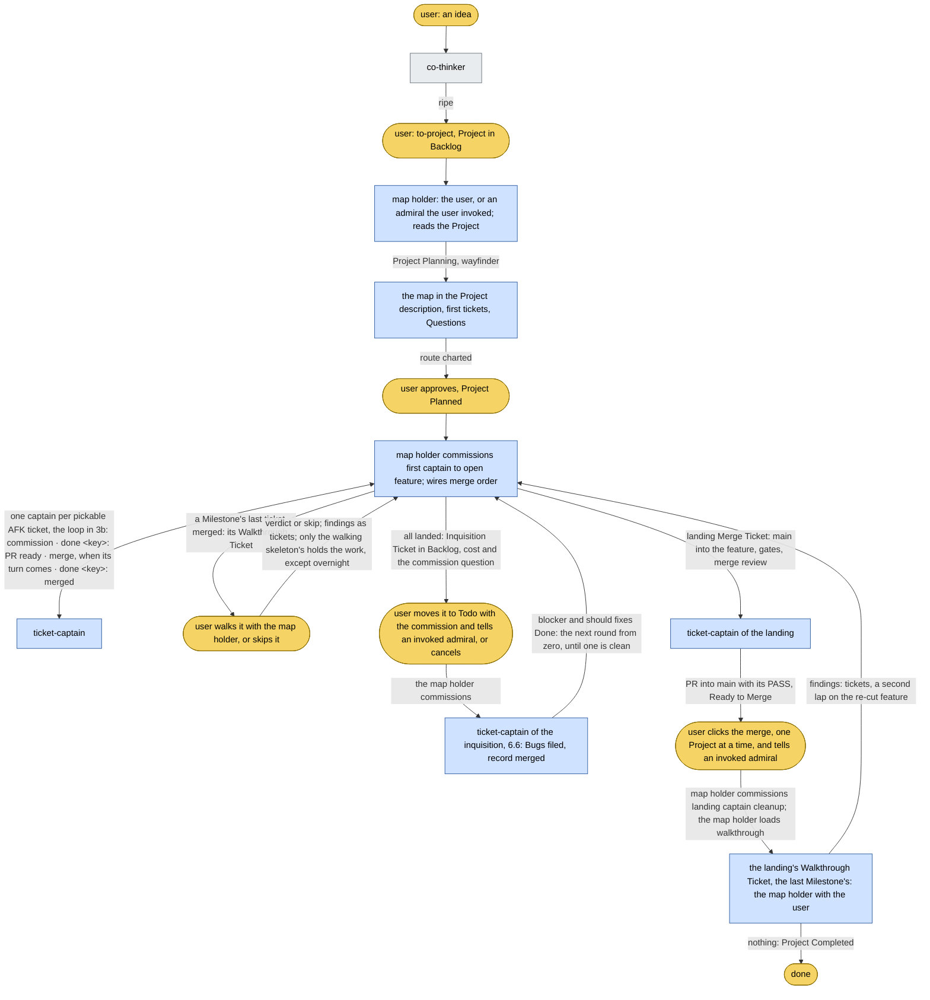
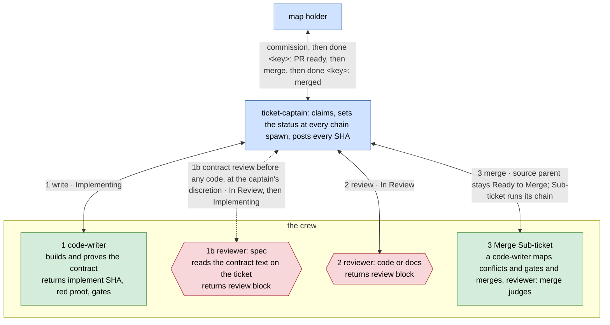
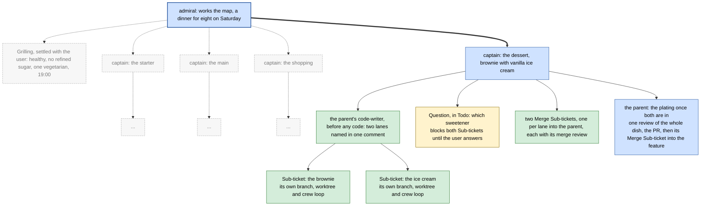

# Control Flow: The Happy Path

[Control Flow](./control-flow.md)

## 3. The happy path

The model is supersymmetric: a captain's ticket is a Project one level down. The same Types, the same
statuses and the same chain hold at both levels; only the map holder changes.

Capability rides with the delegation, not with the role. On every edge below, the delegating role
picks the model - and the effort where the host exposes one - for the crew member it is about to spawn,
weighing what that one task is worth. Nothing dydo compiles makes the choice for it;
[Configuration](../reference/configuration.md) carries each host's resolution order and what its
telemetry can and cannot prove afterwards.

### 3a. One Project

### 3b. One ticket

The captain is the connector: every crew member is briefed by it and returns to it, and it flips the
ticket's status at each chain spawn. The default crew is a `code-writer`, then the fresh
reviewers of [Delivery scale](../guides/working-tree-standard.md#delivery-scale-and-evidence). The dashed edge is the captain's discretion, bought with one short concrete risk reason.

### 3c. The captain divides its ticket, when the writer names lanes

The map already divided the destination into tickets. The captain's first act on its ticket is a
`code-writer` on the parent; before any code it sees whether the ticket holds separate work that can
run at the same time, and if so posts one comment naming the lanes and stops. One dish stays one ticket.

An example with nothing to explain: a dinner for eight on Saturday.

Charting settled the theme through one Grilling Ticket with the user: healthy, no refined sugar, one
vegetarian, food on the table at 19:00. The admiral works that map: three courses cooked in parallel
by three captains, and the shopping, blocked by all three menus. The diagram follows one captain.

- **The dessert's captain divides.** Its code-writer finds, before any code, that brownie and ice
  cream are made separately and at the same time, so the captain opens two Sub-tickets, each
  with its own branch, worktree and crew loop, and keeps the plating on the parent for when both are
  in. Each lane comes back through its own Merge Sub-ticket, one at a time; the dish is reviewed
  once, as a whole.
- **The starter's captain does not.** Its code-writer names no lane: one dish, one crew loop on the parent.
  Dividing is the exception the work has to earn.
- **The sweetener is a Question.** Both Sub-tickets need one, the recipes are silent, and the theme
  rules out sugar. The captain's discovery finds "no refined sugar" on the Grilling and no
  replacement, and research cannot settle a matter of taste, so the captain files a Question
  Sub-ticket under the dessert ticket in `Todo`, wired to block both lanes, priority `Medium` since
  two lanes wait. When the user answers, both resume. Had the question been which sweeteners the whole dinner allows, it would have gone to
  the admiral as a Project-level Question, because its answer reaches the other courses.

The rules the captain applies:

| Decision | Rule |
|---|---|
| Lanes first | the parent's code-writer goes first; before any code it names the lanes in one comment, or posts nothing |
| Lane or parent | a coherent unit too big for one agent or suitable for parallel work may become a Sub-ticket when the officer above decides the cut; ordinary sequential work, the joining step, the parent's scenarios, the one review and the PR stay on the parent |
| What a lane carries | its parent's Type and Mode, a bounded outcome, a disjoint owned-path subset, exact gates, a child-key branch off the parent branch, an isolated worktree, its own status and evidence, its own [code-writer] → [reviewer] loop |
| What proves a lane | its gates; the parent's scenarios prove the joined result |
| Merges are Sub-tickets | each lane into the parent, in order, then the parent into the feature: one Merge Sub-ticket per merge, with its own merge review; never batched. An atomic ticket's own merge into main has none: the user clicks its reviewed PR |
| Depth and cutting | no hard cap; self-similar ticket-captains on Sub-tickets with children. Expected practical ceiling: admiral → captain → sub-captain → second-order sub-captain → crew. The officer above decides the cut; no self-promotion; "too big, re-cut" goes up. Cut coherent units too big for one agent or suitable for parallel work, never merely pass work down. Allowed now without a separate pilot; harmful deep nesting or a failing deeper sub-captain becomes a finding. See the [working-tree standard](../guides/working-tree-standard.md#delegation). |
| Local fog | a Question that touches only this ticket is a Sub-ticket here, in `Todo`; one whose answer reaches other tickets goes to the Project's map holder |

Step by step, with the Linear status each step leaves behind:

1. **Think.** The user brings an idea; the co-thinker does the homework, grills, fixes the words,
   recommends. Output: a DR when the ADR test passes, or ripe intent.
2. **File.** The user types `to-project`: a Linear Project in `Backlog` with the intent, its links
   and its answers. An atomic ticket is filed by the co-thinker with its five fields, one Type and one Mode, in `Todo`.
3. **Chart.** The map holder reads the Project, sets it `Planning`, and charts it with `wayfinder`:
   the map in the Project description, the first pickable tickets in `Todo`, which the user can
   write with `to-ticket`, and the Project-level Questions in `Todo`, wired, with priority by the
   standard's guide. The Project and its tickets are the plan.
4. **Approve.** The user approves the charted route, in an invoked admiral's session when one holds
   the map; the Project becomes `Planned`.
5. **Open.** The map holder commissions the first Ticket Captain to open `feature/<slug>` from the
   approved `main` SHA before claiming its ticket. The map holder keeps the map in the Project description, gives every ticket its base branch and every ticket that merges its final Merge Sub-ticket, wired in plan order, and sets the
   Project `In Progress`. Tickets in
   `Todo` with no open blocker are pickable.
6. **Claim.** The map holder commissions a captain per pickable AFK ticket, and opens a HITL ticket's
   captain in a new top-level thread the user works in. Assignment is the claim; branch, base SHA and worktree path go
   on the ticket before the first edit.
7. **Write.** The captain spawns one `code-writer` and sets `Implementing`. The captain's contract
   says whether the ticket carries Gherkin. The writer posts nothing before code unless the work
   splits into lanes or the contract is inexact; it builds test-driven by Type and ends on the
   `implement` commit whose SHA is posted. A captain that wants the contract judged before the code
   records the one risk in the contract and buys a fresh `reviewer(spec)` on that text, with the
   ticket `In Review` while it runs.
8. **Shape.** When the writer proposes lanes and the officer above authorizes the cut: the captain writes the lane contracts and opens lane
   Sub-tickets in `Todo`, each with its own branch and worktree off the parent branch, plus one Merge
   Sub-ticket per lane, wired in order; the parent sits `In Progress` while its lanes run. Section 3c.
9. **Prove red.** The writer's `IMPLEMENTED` return carries its red proof: an unused-member Bug's definition and
   reference search, any other Bug's reproduction failing with the fix reverted, a Feature's tests failing with the code stashed.
10. **Review.** `In Review`; a fresh reviewer with one rubric returns the standard's one-line
    block, every finding labelled `blocker`, `should` or `nit`. PASS binds that candidate under that
    contract. FAIL, one or more blockers, returns the record to `Implementing`. From either verdict
    the captain files each should as its own ticket and records each nit as one line.
11. **Offer.** The captain pushes the branch, opens the PR into the feature branch with the block in
    its body, sets `Ready to Merge`, and returns `done <key>: PR ready`.
12. **Merge.** When the Merge Sub-ticket's blocker clears, the previous ticket's merge, the map holder
    resumes the captain with one word; when the next PR in plan order is not ready and a ready one
    does not depend on it, the map holder re-wires the order first. Its code-writer merges with `--no-ff`, a
    resolution that refactored leaving its code no worse than either side, before a fresh `reviewer(merge)` judges the integrated feature; PASS sets the Sub-ticket and the primary `Done`.
    The captain cleans up and returns `done <key>: merged`. PR by PR, in plan order, never batched.
    When a Milestone's last ticket has merged, the map holder offers its Walkthrough Ticket; the
    user walks it or skips it, and a skip is a verdict to go on. The walking skeleton's, filed with
    the map, natively blocks the next Milestone's tickets until it closes, except overnight; a later
    Milestone's blocks nothing, and its findings become tickets as they arrive.
13. **Inquisition, rounds until clean.** The map holder files an Inquisition Ticket with its cost
    in `Backlog` and puts the commission question to the user; the user moves it to `Todo` and tells
    an invoked admiral, or cancels; the map holder commissions a captain who runs it, files Bugs,
    which land through the normal loop before the landing, and delivers its own record. Once every
    blocker and should fix is `Done`, the map holder offers the next round from zero, until one
    finds no blocker and no should. Section 6.6.
14. **Land.** The map holder files the landing Merge Ticket, blocked by every open should-ticket; its captain directs a code-writer to merge `main` into
    the feature, a resolution that refactored leaving its code no worse than either side, verifies combined gates, and obtains the merge review that proves the plan's acceptance criteria, opens
    the PR into `main`, sets `Ready to Merge`, and prepares the landing's walkthrough, the last
    Milestone's. The user clicks, one
    Project at a time; the PR lands as a merge commit.
15. **Walk through.** The map holder commissions the landing Captain to clean up after the user
    lands, opens the last Milestone's Walkthrough Ticket and loads `walkthrough` itself, then
    facilitates it. Findings become tickets; the map holder commissions the first fix
    Captain to re-cut the feature from `main` under the same name. Nothing found sets the Project
    `Completed`, with the landing Captain's artifact cleanup confirmed.

## Related

- [Control Flow](./control-flow.md)
