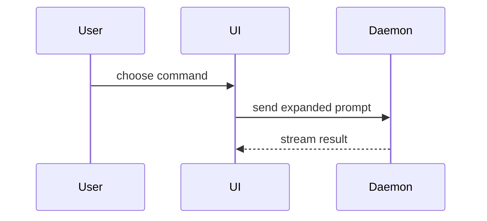

<!-- Adapted from mattpocock/skills pr at 6f7f7831a625f040a8e06a0e7954826b87ce775a (MIT). -->

Write the body for the PR's **merger**: whoever is meant to merge it, often not the user but a coordinator, a captain or a council. The top is theirs: what they must see to merge or refuse, and nothing else. Everything an agent checks goes below, collapsed, so a human merger never filters through it.

Use this template for writing the PR body:

```markdown
**Door:** <two-way | one-way: what a revert cannot undo, in plain words; the recovery plan>

<One sentence: what changed.>

<Only when attached: App recording: <link> · Explainer: <link>>

<Only when this merger needs one visual to decide: that visual, lifted from the Summary>

<Only when this merger needs more to decide: what to check, in plain words>

<details>
<summary>For agents: summary, evidence, review</summary>

## Summary

<diagram, diff-sketch, or tree>

## Evidence

- **Before:** <screenshot/output/failing test run>
  **After:** <screenshot/output/passing test run>

## Blast Radius

<one-word description>

<optional: potential ramifications of merge>

## Independent review

PASS - rubric/type: <docs|code|merge>; candidate <SHA>; base <SHA>; review <Review ticket link, when one exists>

**Deferred:** <should-tickets filed and nits recorded, or none>

</details>
```

Write the body, naming the ticket, to `dydo/agents/workspace/pr-body-<KEY>.md`, an ignored path inside the repo; run `dydo pr-ready --body <that file>` as its own command before opening or readying the PR, and fix what it reports. Open with a lone `gh pr create --body-file <that file>`, nothing chained, piped or redirected, so the guard reads the body.

## Sections

Skip all preambles and keep prose brief. Use the user's domain language from `dydo/glossary.md`.

### The top

The door line comes first, then the sentence; nothing precedes them. A human merger may decide on these two lines only when they hold everything that merger needs; the merge gates (review, gates on the combined tree, CI) still apply.

- **Door.** A two-way door is one a revert walks back through; a one-way door is one a revert cannot undo. These kinds are one-way however easy their revert, and this list overrides the revert test: data migrations; publishing a package or a public API; anything sent outside the repo; secrets; history rewrites; changes to what guards main (CI, branch protection, release workflows, the guard). The list's home is the Merging section of `dydo/guides/working-tree-standard.md`, from the repository root; where the two differ, that file wins. For one-way, say in plain words what a revert would not undo, and how to recover.
- **Sentence.** One sentence on what changed, in the merger's terms.
- **Decision context.** Add lines only for what this merger must inspect that the door and sentence do not show. Give the reader everything needed to decide, in plain words. A ticket key or Decision Record number appears only as a link beside the meaning it stands for: "the merge guard still reads the review line ([ABC-123](<ticket URL>))", never "per ABC-123 and DR 52".

### Videos

Videos are optional help for the merger. Attach both, one or neither, by what this merger will inspect; that holds for a big PR too, and most PRs need none.

- **App recording**: someone or something driving the app through the change, showing how the feature actually behaves. Consider one when seeing the feature driven helps this merger decide, typically for a bigger user-visible change. Evidence names it too.
- **Explainer**: a narrated walk through the problem and how it was solved, made with the `animatic` skill. Consider one when hearing the reasoning helps this merger more than reading it. It goes alongside the Summary, not in place of it.
- **Both** when each adds something the other does not; **neither** when the body already gives the merger enough.

Link them on the line under the sentence.

### For agents

The `<details>` block holds the proof and review notes. Keep `## Independent review` a level-two heading and the last section in the block: `dydo pr-ready` and `dydo merge` read it up to the next level-one or level-two heading. It holds one PASS line in the template's form, written with the verdict, then `**Deferred:**`. Keep a blank line after `<summary>` and before `</details>` so the markdown inside renders.

#### Summary

Pick the smallest view that makes the key point clear.

- Show logic or an algorithm as pseudocode:

```text
on(save)
  if content is unchanged
    return cached result
  write new content
  return fresh result
```

- Show runtime control flow as a call tree:

```text
submitForm
  createSession
    persistPrompt
    launchAgent
  navigateToSession
```

- Show UI structure as a component tree, including state and module boundaries that matter:

```text
<SessionPage> (apps/example/src/routes/session.tsx)
  useSessionEvents()
  <SessionToolbar>
    <RunSkillButton> (packages/ui)
```

- Show file responsibility or a broad refactor as a shallow file tree:

```text
src/
├── commands/       # parses user actions
├── sessions/       # owns session state
└── transport/      # sends API requests
```

- Show component interaction, control flow, or data flow with Mermaid:



- Use `diff` when the point is what changes and the surrounding shape already exists. Match the diff shape to the topic.

For a component change:

```diff
 <SessionPage>
   useSessionEvents()
   <SessionToolbar>
+    <RunSkillButton />
   <SessionTimeline>
+    <SkillResultCard />
```

For a file-layout change:

```diff
 src/
 ├── commands/
+│   └── show-me.ts       # expands the slash command
 ├── sessions/
-└── transport.ts
+└── transport/
+    ├── client.ts
+    └── stream.ts
```

For a call-tree or call-stack change:

```diff
 submitForm
   createSession
     persistPrompt
+    expandSkillMention
     launchAgent
-  navigateToSession
+  navigateToSession
+    subscribeToEvents
```

For a state or control-flow change:

```diff
 on(save)
-  write content
+  if content is unchanged
+    return cached result
+  write new content
+  invalidate cache
```

- Show the whole block when most of it is new, when omitted context would hide ownership or order, or when the user needs a copyable target shape:

```ts
function expandSkill(command: string): string {
  const skillName = command.slice(1);
  return `use the ${skillName} skill`;
}
```

Place each visual next to the short text it supports. Keep only the calls, files, props, states, and boundaries needed to answer the user's current question or the options to resolve the current discussion point.

You may use one of these, you may use several, it is unlikely you will use all of them. Use your judgement and don't overwhelm the user. When the merger needs one visual to decide, lift it to its slot at the top, after the video line.

#### Evidence

Concrete evidence that the change works. Show a before and after.

Screenshots are S-tier - when the environment is set up for it and the change is visual.

Execution-based evidence is A-tier. Test results, console output. Show the exact test that now fails and passes, using pseudocode.

#### Blast Radius

The blast radius is the potential impact or scope of the changes introduced by this PR. Consider all possibilities. Examples are layout shift, breakages for consumers, mobile responsiveness, etc.
